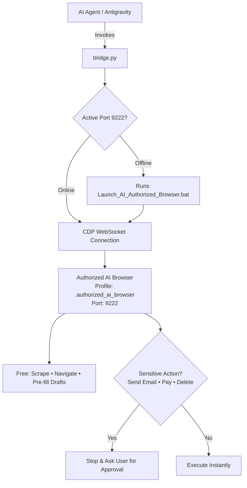

# 🌐 Browser Bridge

[](https://opensource.org/licenses/MIT)
[](https://www.python.org/)
[](https://microsoft.com/windows)
[](https://github.com/ATP0925/browser-bridge)
[](https://github.com/ATP0925/browser-bridge)

> **Dedicated desktop browser bridge for AI coding agents.** Connects sandboxed AI assistants directly to an **Authorized AI Browser** (`%USERPROFILE%\.authorized_ai_browser` on CDP port `9222`) while keeping your personal everyday browser completely isolated and enforcing a strict **Sensitive Action Permission Protocol**.

---

## 🛡️ Core Architecture & Operational Rules

Unlike fragile headless browsers or unsafe tools that tamper with your personal browser sessions, `browser-bridge` operates on two foundational principles:

1. **Dedicated AI-Authorized Profile (`.authorized_ai_browser`)**:
   - The AI interacts exclusively with a dedicated browser instance launched via your desktop shortcut (`Launch_AI_Authorized_Browser.bat`).
   - Your primary personal browser, everyday tabs, and personal profiles are **never** touched or modified.
2. **Autonomous Exploration + Sensitive Action Approval Protocol**:
   - **Autonomous (No Permission Needed)**: The AI is free to browse, navigate, extract DOM data, scrape, analyze pages, and pre-fill drafts.
   - **Gated Sensitive Actions (Mandatory Approval)**: Before executing any consequential action—such as **sending an email**, **making a payment**, **placing an order**, or **deleting data**—the agent **MUST ask for the owner's explicit confirmation**.

---

## ⚡ The Architecture



---

## 🔒 Sensitive Action Permission Matrix

| Operation Category | Action Examples | Agent Autonomy | Owner Approval Required? |
| :--- | :--- | :--- | :--- |
| **Observation** | Reading page text, inspecting DOM, status checks | ✅ Full Autonomy | ❌ No |
| **Navigation** | Opening URLs, switching tabs, reloading | ✅ Full Autonomy | ❌ No |
| **Drafting** | Pre-filling email body, filling search inputs | ✅ Full Autonomy | ❌ No |
| **Outreach Dispatch** | Clicking "Send" in Gmail or messaging apps | ⚠️ Gated Action | **✅ YES (Owner Approval Required)** |
| **Financial / Cart** | Clicking "Pay", entering CVV, placing orders | ⚠️ Gated Action | **✅ YES (Owner Approval Required)** |
| **Destructive** | Deleting accounts, dropping databases, clearing data| ⚠️ Gated Action | **✅ YES (Owner Approval Required)** |

---

## 🚀 Quick Start

### 1. Launching the Authorized Browser
Double-click your desktop shortcut:
```text
C:\Users\atpad\OneDrive\Desktop\Launch_AI_Authorized_Browser.bat
```
*(Or let `bridge.py` auto-launch it on demand).*

### 2. CLI Usage

#### Check Connection & List Active Tabs
```powershell
python scripts/bridge.py status
```
*Output:*
```text
=================================================================
 🛡️  AUTHORIZED AI BROWSER BRIDGE — LIVE STATUS
=================================================================
✅ Connection Status : ACTIVE & CONNECTED
📍 Authorized Port   : 9222
🚀 Browser Engine    : Chrome/156.0.8078.80
📁 Isolated Profile  : %USERPROFILE%\.authorized_ai_browser
🔒 Safety Protocol   : ENFORCED (Sensitive actions require owner approval)

📑 Active Authorized Tabs (9):
   [1] AWS Builder Center          | https://builder.aws.com/
   [2] Inbox - Gmail               | https://mail.google.com/mail/u/0/
   [3] Stick It Up Store           | https://www.stickitup.xyz/
```

#### Pre-fill an Email in Authorized Gmail
```powershell
python scripts/bridge.py gmail \
  --to "client@example.com" \
  --subject "Project Audit Findings" \
  --body "Hi, here are the review details..."
```
*The compose window opens pre-filled in your Authorized Browser. The agent halts and awaits your permission before sending.*

#### Open Any URL or Inspect Elements
```powershell
# Open URL
python scripts/bridge.py open "https://github.com/ATP0925"

# Evaluate JavaScript inside tab
python scripts/bridge.py eval "document.title" --filter "stickitup"
```

---

## 🤖 Agent Skill Integration

Add `browser-bridge` to your AI coding assistant (Antigravity, Claude Code, Cursor, Codex):

```bash
# Clone or copy into your agent skills directory
cp -r browser-bridge ~/.gemini/config/skills/browser-bridge
```

---

## 📁 Repository Structure

```text
browser-bridge/
├── SKILL.md              # Agent skill manifest & permission rules
├── README.md             # Complete open source documentation
├── LICENSE               # MIT License
├── requirements.txt      # Python dependencies
├── pyproject.toml        # Package & CLI metadata
└── scripts/
    ├── bridge.py         # Unified CLI (Edge & Chrome via Port 9222)
    ├── cdp_engine.py     # Resilient CDP WebSocket protocol client
    ├── cdp_client.py     # Low-level DevTools protocol client
    └── os_automation.py  # Native UI automation fallback helpers
```

---

## 🛡️ License

Distributed under the **MIT License**. See [`LICENSE`](LICENSE) for details.

Developed with ❤️ by [ATP0925](https://github.com/ATP0925).
