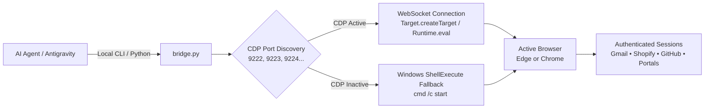

# 🌐 Browser Bridge

[](https://opensource.org/licenses/MIT)
[](https://www.python.org/)
[](https://microsoft.com/windows)
[](https://github.com/ATP0925/browser-bridge)
[](https://github.com/ATP0925/browser-bridge)

> **Universal desktop browser bridge for AI coding agents.** Connects sandboxed agents to the user's running, authenticated **Microsoft Edge** and **Google Chrome** desktop browsers via the Chrome DevTools Protocol (CDP) and native OS fallbacks.

---

## 💥 The Problem: Why Agents Get Trapped in Sandboxes

When an AI agent (in Antigravity, Claude Code, Codex, or Cursor) tries to interact with the internet or perform user-directed actions, it frequently hits the **Sandbox Boundary**:

1. **Headless Browsers Lack Logins**: Standard Playwright/Puppeteer instances start with fresh, blank profiles. They cannot access the user's logged-in Gmail, GitHub, Shopify, or internal enterprise dashboards without complex session exports or 2FA hurdles.
2. **OS Process Isolation (UIPI)**: Background agent subprocesses are prohibited by Windows User Interface Privilege Isolation from simulating keystrokes (`pyautogui`, `SendKeys`) on elevated desktop applications.
3. **Session Interruption**: Aggressive automation scripts often terminate (`taskkill`) running browsers to restart them with debug flags, destroying user tabs and causing workflow disruption.

---

## ⚡ The Solution: Browser Bridge Architecture

`browser-bridge` connects your AI agent directly to your **existing, live browser** without requiring credential storage or destructive restarts.



---

## ✨ Features

- **Dual Browser Engine**: Automatically detects and controls both **Microsoft Edge** and **Google Chrome**.
- **Zero-Credential Security**: Never asks for or stores passwords or cookies. Drives actions through the user's already-authenticated browser session.
- **1-Click Gmail Automation**: Instantly dispatches or drafts pre-filled emails with recipient, subject, and body pre-loaded into the user's live Gmail account.
- **Graceful Fallbacks**: If CDP remote debugging is not attached, it seamlessly falls back to Windows native ShellExecute to open requested tasks in the user's default browser.
- **Non-Destructive**: Never kills user tabs or forces profile wipes.

---

## 🚀 Quick Start

### 1. Installation

```bash
git clone https://github.com/ATP0925/browser-bridge.git
cd browser-bridge
pip install -r requirements.txt
```

*(Optional) Install in editable mode for global CLI access:*
```bash
pip install -e .
```

### 2. CLI Usage

#### Check Browser Connection Status
```bash
python scripts/bridge.py status
```
*Output:*
```text
============================================================
 🌐 BROWSER BRIDGE — LIVE STATUS
============================================================
✅ CDP Status   : CONNECTED
📍 Debug Port   : 9222
🚀 Browser      : Chrome/156.0.8078.80
📑 Open Tabs    : 8
   [1] Inbox (531) - Gmail -> https://mail.google.com/mail/u/0/
   [2] Stick It Up Store -> https://www.stickitup.xyz/
```

#### Dispatch Pre-filled Gmail Compose Window
```bash
python scripts/bridge.py gmail \
  --to "client@example.com" \
  --subject "Project Audit Findings" \
  --body "Hi, here are the review details..."
```

#### Open Any URL in Active Browser
```bash
python scripts/bridge.py open "https://github.com/ATP0925"
```

#### Execute JavaScript in Active Tab
```bash
python scripts/bridge.py eval "document.title"
```

---

## 🤖 Agent Skill Integration

To add `browser-bridge` to your AI coding assistant (Antigravity, Claude Code, Cursor, Codex):

1. Copy the repository into your agent's skills directory:
   ```bash
   # For Antigravity / Gemini CLI:
   cp -r browser-bridge ~/.gemini/config/skills/browser-bridge

   # For Claude Code:
   cp -r browser-bridge ~/.claude/skills/browser-bridge
   ```
2. The agent reads `SKILL.md` and gains instant access to drive live browser tabs and bypass sandbox limitations whenever you ask it to open, compose, review, or scrape authenticated web pages.

---

## 📁 Repository Structure

```text
browser-bridge/
├── SKILL.md              # Agent skill manifest & trigger definitions
├── README.md             # Complete open source documentation
├── LICENSE               # MIT License
├── requirements.txt      # Python dependencies
├── pyproject.toml        # Package & CLI metadata
└── scripts/
    ├── bridge.py         # Main unified CLI (Edge & Chrome)
    ├── cdp_engine.py     # Resilient CDP WebSocket client & port scanner
    ├── cdp_client.py     # Low-level Chrome DevTools protocol client
    └── os_automation.py  # Native Windows UI automation fallbacks
```

---

## 🛡️ License

Distributed under the **MIT License**. See [`LICENSE`](LICENSE) for details.

Developed with ❤️ by [ATP0925](https://github.com/ATP0925).
