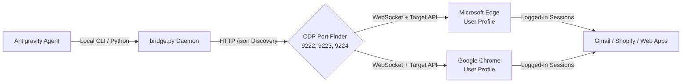

# Browser Bridge — Live Desktop Browser Control Skill

## 🎯 Purpose & Capabilities
`browser-bridge` eliminates the sandbox barrier between the AI agent and the user's desktop browser. It allows the agent to control the user's **already authenticated, logged-in browser** (both **Microsoft Edge** and **Google Chrome**) without needing credentials, fake profiles, or headless workarounds.

### Key Capabilities:
1. **Authenticated Email Dispatch**: Compose and review/send emails directly through logged-in Gmail sessions.
2. **Login-Walled Site Extraction**: Read internal dashboards, Shopify admin portals, orders, or private repositories.
3. **Dual Browser Support**: Seamlessly detects and controls either **Microsoft Edge** or **Google Chrome**.
4. **Non-Destructive Session Connection**: Connects via Chrome DevTools Protocol (CDP) WebSocket without killing user tabs or losing work.

---

## ⚡ Quick Start CLI

```bash
# 1. Check browser bridge status & discover open tabs
python C:\Users\atpad\.gemini\config\skills\browser-bridge\scripts\bridge.py status

# 2. Open a pre-filled Gmail compose tab in the user's active browser
python C:\Users\atpad\.gemini\config\skills\browser-bridge\scripts\bridge.py gmail --to "client@example.com" --subject "Review" --body "Message body..."

# 3. Open any URL in a new tab
python C:\Users\atpad\.gemini\config\skills\browser-bridge\scripts\bridge.py open "https://example.com"

# 4. Execute JavaScript inside an active tab
python C:\Users\atpad\.gemini\config\skills\browser-bridge\scripts\bridge.py eval "document.title"

# 5. Launch / attach Edge or Chrome with persistent CDP enabled
python C:\Users\atpad\.gemini\config\skills\browser-bridge\scripts\bridge.py start --browser edge
```

---

## 🏗️ Architecture: How It Bypasses Sandbox Limits



### Why Standard Sandbox Calls Fail:
- Agent CLI commands run in isolated child process sessions on Windows.
- Standard tools cannot simulate global mouse clicks on external desktop applications due to Windows User Interface Privilege Isolation (UIPI).
- Third-party headless browsers lack the user's cookies, 2FA tokens, and authenticated logins.

### How Browser-Bridge Solves It:
- Communicates directly via **Chrome DevTools Protocol (CDP)** over `localhost` WebSockets.
- The browser handles rendering, cookies, authentication, and execution natively.
- Zero credential handling required by the agent—uses the user's real session.

---

## 📁 Component Structure

* [`SKILL.md`](file:///C:/Users/atpad/.gemini/config/skills/browser-bridge/SKILL.md) — Documentation and guide.
* [`scripts/bridge.py`](file:///C:/Users/atpad/.gemini/config/skills/browser-bridge/scripts/bridge.py) — Core unified CLI supporting Edge and Chrome.
* [`scripts/cdp_engine.py`](file:///C:/Users/atpad/.gemini/config/skills/browser-bridge/scripts/cdp_engine.py) — Robust WebSocket CDP client with automatic reconnection and multi-target support.
